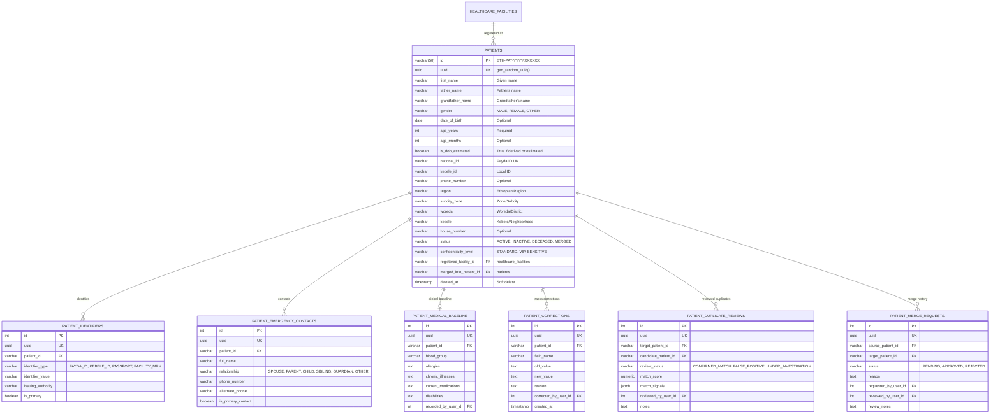

# CareConnect Ethiopia — Patient Domain Data Model & Governance Architecture

## 1. Overview & Healthcare Context

The **Patient Management Domain** in CareConnect Ethiopia establishes a secure, unified patient demographic, identification, and baseline clinical model. It addresses specific Ethiopian healthcare operational realities:

1. **Patronymic Naming System**: Ethiopian individuals typically do not use Western hereditary family surnames. Instead, naming follows **Given Name (First Name)**, **Father's Name**, and **Grandfather's Name**.
2. **Age & Birth Date Optionality**: Exact calendar birth dates may not be known by rural or elderly patients. The system supports direct `age_years` and `age_months` entry with an `is_dob_estimated` flag, while optionally accepting exact calendar `date_of_birth` when available.
3. **Communication Optionality**: Cellular coverage and phone ownership vary across regional woredas. A patient phone number is **strictly optional** and missing contacts must never block emergency or routine registration.
4. **National & Regional Identifiers**:
   - **Fayda ID**: Ethiopian National ID system (`national_id`).
   - **Kebele ID**: Neighborhood administrative residence identification card (`kebele_id`).
   - **Facility MRN**: Standardized institutional Medical Record Number (`medical_record_number`).
5. **Administrative Geography**: Structured hierarchical addressing following Ethiopian governance: `region`, `subcity_zone`, `woreda`, `kebele`, and `house_number`.

---

## 2. Relational Entity Structure

The patient domain is structured across normalized tables to ensure relational integrity, auditability, and clinical safety:

---

## 3. Privacy, Authorization & Facility Isolation Boundaries

Access to patient records is governed by strict Role-Based Access Control (RBAC) and facility tenancy boundaries:

| Portal / Role | Registration | Demographics Search | Clinical Record View | Emergency Contacts | Merge / Duplicate Review |
|---|---|---|---|---|---|
| **Health Centre Staff** | ✅ Full at registered facility | ✅ Filtered by facility tenancy | ✅ Full clinical history | ✅ Manage contacts | ✅ Flag & Submit Review |
| **Hospital Staff / Triage** | ❌ Read-only via Referral | ⚠️ Only referred patients | ✅ Clinical view for admitted/referred | ✅ View only | ⚠️ Report collision |
| **Transport Coordinator** | ❌ No direct registration | ❌ Restricted | ⚠️ Minimum journey-essential only | ✅ View primary contact | ❌ No access |
| **System Administrator** | ❌ No direct clinical entries | ⚠️ Audit & system search | ❌ Restricted from raw medical charts | ⚠️ Technical oversight | ✅ Oversee approval workflow |

---

## 4. Duplicate Detection & Clinical Human-in-the-Loop Review

Automatic merging of medical identities presents severe clinical risks (e.g., misassigned medications, incompatible blood transfusions). The system strictly enforces:

1. **Scoring Signals**:
   - Exact Fayda / National ID match: **Confirmed Match candidate (High priority)**.
   - Exact phone number + matching Given & Father names: **Probable candidate**.
   - Identical Patronymic 3-name tuple + matching Woreda + birth year: **Possible candidate**.
2. **Never Automatic**: Matches trigger candidate flags (`/api/v1/patients/identify` and `/api/v1/patients/:id/possible-duplicates`).
3. **Mandatory Human Review**: An authorized clinician or medical records officer must review duplicate candidates (`POST /api/v1/patients/:id/duplicate-review`) or initiate formal merge requests (`POST /api/v1/patients/merge-requests`) with documented clinical justification.
