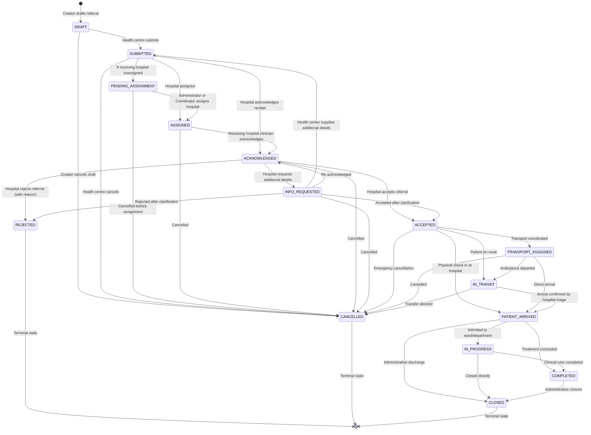

# CareConnect Ethiopia — Digital Referral Architecture & State Machine Specification

## 1. System Overview & Healthcare Context

CareConnect Ethiopia coordinates patient transfers between primary Health Centres and tertiary/specialized Hospitals. The digital referral management subsystem guarantees:

1. **Clinical Human-in-the-Loop Decisions**: Qualified healthcare clinicians make and review all triage decisions. AI recommendations (OCR, triage scoring, destination suggestions) never autonomously accept, reject, or assign patients.
2. **Deterministic State Machine**: Referrals strictly adhere to an explicit finite state machine. Arbitrary status modifications are rejected.
3. **Traceability & Immutable Audit**: Every state transition, triage decision, acknowledgement, priority change, and demographic/clinical correction is recorded with actor ID, facility context, timestamps, and justifications.
4. **Strict Privacy Boundaries**:
   - Health Centres only track their outgoing referrals.
   - Hospitals only inspect incoming referrals directed to or eligible for their facility.
   - Transport Coordinators receive only journey-essential parameters (pickup origin, destination hospital, priority, emergency contacts; detailed clinical charts and sensitive diagnoses are redacted).
   - Public/Patient Reference Tracking returns operational milestones without exposing identifying demographic or clinical text.

---

## 2. Referral Lifecycle State Machine

The referral workflow enforces atomic state transitions:

---

## 3. Allowed Transition Matrix

| Current Status | Permitted Target Statuses | Required Conditions & Actors |
|---|---|---|
| `DRAFT` | `SUBMITTED`, `CANCELLED` | Referring Clinician at Origin Facility |
| `SUBMITTED` | `PENDING_ASSIGNMENT`, `ASSIGNED`, `ACKNOWLEDGED`, `CANCELLED` | Referring Clinician / Hospital Clinician / System Admin |
| `PENDING_ASSIGNMENT` | `ASSIGNED`, `CANCELLED` | Health Centre Clinician / Regional Admin / Coordinator |
| `ASSIGNED` | `ACKNOWLEDGED`, `CANCELLED` | Assigned Hospital Triage Clinician |
| `ACKNOWLEDGED` | `ACCEPTED`, `REJECTED`, `INFO_REQUESTED`, `CANCELLED` | Assigned Hospital Triage Clinician (Decision reason mandatory for reject/info) |
| `INFO_REQUESTED` | `SUBMITTED`, `ACKNOWLEDGED`, `ACCEPTED`, `REJECTED`, `CANCELLED` | Origin Clinician provides info OR Hospital acts |
| `ACCEPTED` | `TRANSPORT_ASSIGNED`, `IN_TRANSIT`, `PATIENT_ARRIVED`, `CANCELLED` | Hospital Clinician / Transport Coordinator |
| `TRANSPORT_ASSIGNED`| `IN_TRANSIT`, `PATIENT_ARRIVED`, `CANCELLED` | Transport Driver / Hospital Triage |
| `IN_TRANSIT` | `PATIENT_ARRIVED`, `CANCELLED` | Receiving Hospital Triage Staff |
| `PATIENT_ARRIVED` | `IN_PROGRESS`, `COMPLETED`, `CLOSED` | Receiving Hospital Clinical Staff |
| `IN_PROGRESS` | `COMPLETED`, `CLOSED` | Attending Hospital Physician / Specialist |
| `COMPLETED` | `CLOSED` | Hospital Medical Records / Admin |
| `REJECTED` | *None (Terminal)* | Immutable historical record |
| `CANCELLED` | *None (Terminal)* | Immutable historical record |
| `CLOSED` | *None (Terminal)* | Immutable historical record |

---

## 4. Concurrency Protection Strategy

Referrals involve concurrent interactions between referring health centres, receiving hospitals, and dispatch coordinators:

1. **State Transition Guards**: Every mutation validates the current status against expected preconditions prior to applying updates (`WHERE id = $id AND status = $expectedStatus`).
2. **Transaction Isolation**: Multi-table updates (`referrals`, `referral_status_history`, `referral_events`, and `referral_decisions`) execute inside atomic PostgreSQL transactions or transactional in-memory buffers.
3. **Decision Idempotency**: Simultaneous hospital triage submissions on the same referral cannot produce divergent decisions. The first processed decision commits, causing subsequent concurrent attempts to be rejected with `409 Conflict` or `400 Bad Request`.
4. **Non-Guessable Human-Readable Reference**: Human-readable referral references (`ETH-REF-YYYY-XXXXXX`) combine year and CSPRNG cryptographic hexadecimal tokens to prevent enumeration attacks, generated safely under concurrency.

---

## 5. Notification & Audit Integration

Referral milestones emit structured events:
- `REFERRAL_CREATED`
- `REFERRAL_SUBMITTED`
- `REFERRAL_ASSIGNED`
- `REFERRAL_ACKNOWLEDGED`
- `REFERRAL_ACCEPTED`
- `REFERRAL_REJECTED`
- `REFERRAL_INFO_REQUESTED`
- `REFERRAL_ARRIVAL_CONFIRMED`
- `REFERRAL_PROGRESS_UPDATED`
- `REFERRAL_COMPLETED`
- `REFERRAL_CLOSED`
- `REFERRAL_CANCELLED`
- `REFERRAL_CORRECTED`

Events are buffered into `system_events` and `audit_logs` without blocking core transactions on external network providers.
