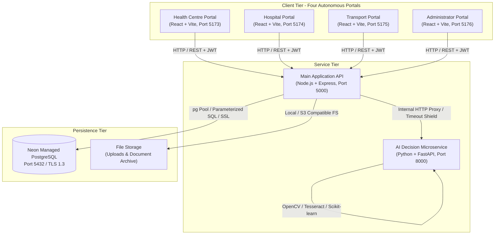
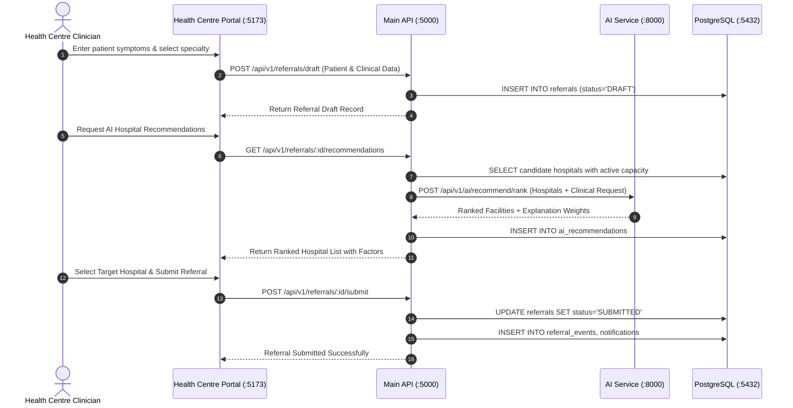

# CareConnect Ethiopia — System Architecture Documentation

## 1. High-Level Architecture Overview

CareConnect Ethiopia employs a decoupled, service-oriented multi-portal architecture specifically architected for resilient healthcare coordination in Ethiopia.

For the comprehensive functional description, clinical problem statement, and portal feature matrices, see [PROJECT_OVERVIEW.md](file:///C:/Users/DELL%207020/Desktop/CareConnect%20Ethiopia%20Healthcare%20Dashboard%20Collage/docs/PROJECT_OVERVIEW.md).

---

## 2. Portals Architecture

Each portal is an autonomous React 18 single-page application bundled with Vite. Each has its own dedicated entry point, routing, state management, and authentication token lifecycle.

| Application | Port | User Persona | Core Functionality |
|---|---|---|---|
| **Health Centre Portal** | `5173` | Clinicians, Health Officers | Patient registration, electronic referral drafting, paper scan OCR upload, AI facility recommendation review, referral dispatch. |
| **Hospital Portal** | `5174` | Triage Doctors, Admission Staff | Real-time incoming referral queue, clinical triage review, bed/ICU reservation, decision recording (Accept/Reject/Info Request), arrival check-in. |
| **Transport Portal** | `5175` | Transport Dispatchers, EMTs | Ambulance fleet status, transport request queue, crew assignment, live transit milestone updates, route distance mapping. |
| **Administrator Portal** | `5176` | System Admins, Regional Health Bureau | Facility registry & bed capacity oversight, role & permission governance, audit log exploration, AI model versioning & accuracy analytics. |

### Shared Frontend Design System
All four portals share a unified visual language and design token system located in `shared/`:
- Tailwind CSS color palettes calibrated for healthcare (Emerald green for health centres, Blue for hospitals, Amber/Orange for transport, Indigo for administration).
- Lucide React icon library.
- Recharts data visualization.
- Leaflet / OpenStreetMap mapping widgets.

---

## 3. Backend Services Architecture

### 3.1 Main API (Node.js + Express, Port 5000)
The main API serves as the orchestration engine, business logic coordinator, and authoritative data gateway.
- **Layered Structure**:
  - `config/`: Environment configuration, database pool initialization, AI service client options.
  - `controllers/`: HTTP request/response handlers with status code mapping.
  - `middleware/`: Authentication (`verifyToken`), RBAC (`requireRole`), facility tenancy (`enforceFacilityAccess`), input validation (`validateRequest`), error boundary.
  - `models/`: Database query abstraction, data access objects (DAOs).
  - `routes/`: Modularized API endpoints under `/api/v1/...`.
  - `services/`: Core business logic (referral lifecycle state machine, notification generation, distance calculation).
  - `validators/`: Joi / express-validator schemas for strict payload validation.
  - `utils/`: Token generators, password hashers, logger helpers.

### 3.2 AI Service (Python + FastAPI, Port 8000)
The AI service is an isolated Python microservice handling compute-heavy NLP, machine learning, and optical character recognition tasks.
- **Components**:
  - `api/`: FastAPI route routers (`/ocr/extract`, `/recommend/rank`, `/predict/delay`, `/assistant/query`).
  - `core/`: Config settings, CORS, telemetry, model loading lifecycle events.
  - `services/`:
    - `ocr_service.py`: Tesseract OCR engine, OpenCV bilateral filtering, thresholding, deskewing.
    - `recommendation_service.py`: Multi-criteria hospital ranking and explanation generator.
    - `classification_service.py`: Scikit-learn TF-IDF + Logistic Regression clinical specialty classifier.
    - `delay_prediction_service.py`: Historical referral delay estimator.
    - `nlp_service.py`: Multilingual text normalization (English and Amharic Fidel text).
    - `assistant_service.py`: Knowledge-grounded administrative assistant.
  - `schemas/`: Pydantic models for type-safe request/response contracts.

---

## 4. Sequence Workflows

### 4.1 Referral Creation and AI Facility Recommendation Flow

---

## 5. Security Architecture
1. **Network Boundary Protection**: The AI service operates as an internal microservice, communicating through backend API forwarding or protected tokens.
2. **CORS Whitelist**: Explicit origins allowed: `http://localhost:5173`, `http://localhost:5174`, `http://localhost:5175`, `http://localhost:5176`.
3. **Password Security**: Cryptographic one-way hashing with bcrypt.
4. **JWT Security**: Access tokens signed with `JWT_SECRET` (256-bit HMAC); refresh tokens stored with revocation support.
5. **Auditing**: Every status change and patient access is committed to `audit_logs`.
