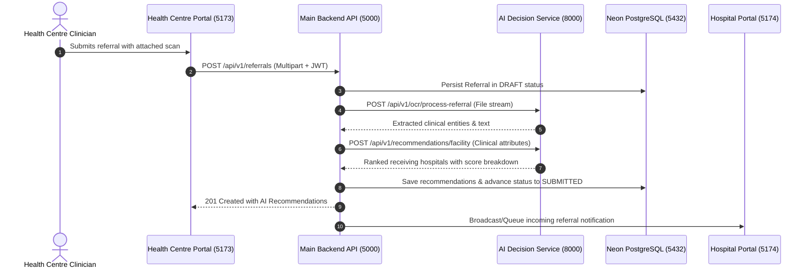

# CareConnect Ethiopia — Complete Project Overview

## 1. Project Identity & Purpose

**Project Name:** CareConnect Ethiopia  
**Full Official Name:** AI-Powered Smart Healthcare Referral and Patient Coordination System  
**System Class:** National Tiered Healthcare Referral & Emergency Logistics Coordination Platform  

CareConnect Ethiopia is an intelligent digital health platform engineered to bridge the critical operational divide between primary health centres and secondary/tertiary referral hospitals across Ethiopia. The platform transforms manual, paper-reliant, and uncoordinated patient transfers into an automated, transparent, and auditable digital continuum.

### Key Objectives
1. **Reduce Emergency Transit & Referral Delay:** Coordinate critical patient transfers in real time with automated bed, ICU, and surgical capacity checks.
2. **AI-Assisted Referral & Triage Processing:** Extract clinical data from physical referral slips using Optical Character Recognition (OCR) and computer vision, and compute explainable hospital recommendations based on distance, specialty availability, and live capacity.
3. **End-to-End Referral Visibility:** Track every referral state transition from creation at the health centre to ambulance transit, hospital acceptance, patient arrival, and clinical outcome feedback.
4. **Transport & Ambulance Resource Optimization:** Centralize regional ambulance fleet dispatch, driver/paramedic assignment, departure/arrival timestamps, and delay telemetry.
5. **Multi-Tenant Clinical Governance & Auditability:** Provide role-based access control, facility-level tenancy isolation, and immutable audit logging for Ministry of Health and Regional Health Bureau oversight.

---

## 2. The Four Independent Portals

CareConnect Ethiopia delivers four dedicated, standalone web applications, each tailored to specific clinical and administrative workflows. All portals run independently on isolated ports with dedicated routing and authentication token lifecycles.

```text
+-----------------------------------------------------------------------------------+
|                            CareConnect Ethiopia Portals                           |
+-------------------------+-------------------------+-------------------------------+
| Health Centre Portal    | Hospital Portal         | Transport Coordinator Portal  |
| Port: 5173              | Port: 5174              | Port: 5175                    |
| Clinicians & Officers   | Triage & Admissions     | Dispatchers & Paramedics      |
+-------------------------+-------------------------+-------------------------------+
| System Administrator Portal (Port: 5176) - RHB & System Governance             |
+-----------------------------------------------------------------------------------+
```

### 2.1 Health Centre Portal (`http://localhost:5173`)
Designed for primary healthcare workers, nurses, and health officers at rural and urban health centres:
- **Patient Registration:** Fast intake with Fayda National ID, local kebele/woreda demographics, emergency contact, and baseline medical history.
- **Referral Creation:** Structured clinical referral capture including chief complaint, provisional diagnosis, ICD-10 categorization, vitals, and clinical priority (Routine, Priority, Urgent, Emergency).
- **Document Upload:** Multi-format clinical attachment upload (lab results, handwritten paper referral notes, ultrasound reports).
- **AI-Assisted Referral Processing:** Automatic OCR text extraction and clinical entity detection to eliminate manual re-keying of paper referral forms.
- **Hospital Recommendations:** Ranked list of appropriate receiving facilities computed by the AI engine considering travel time, road conditions, required clinical specialties, and current bed availability.
- **Referral Tracking:** Real-time visibility into whether the referral has been acknowledged, accepted, rejected, or scheduled for ambulance dispatch.

### 2.2 Hospital Portal (`http://localhost:5174`)
Tailored for receiving triage physicians, emergency department heads, and admission coordinators at general, specialized, and comprehensive hospitals:
- **Incoming Referrals Queue:** Live feed of incoming referral requests filtered by clinical urgency and triage level.
- **Referral Acknowledgement:** Rapid receipt acknowledgement with time-stamped clinical notification to the referring facility.
- **Acceptance & Rejection Decisions:** Authoritative clinical decision recording with reason codes, assigned receiving department, and designated attending clinician.
- **Additional Information Requests:** Bidirectional communication channel requesting additional diagnostic tests, lab panels, or clinical stabilization before transit.
- **Patient Arrival Confirmation:** One-click check-in upon physical arrival at the emergency room or triage desk, terminating the transit phase.
- **Facility Services & Capacity Management:** Daily and shift-based updates of bed occupancy (General, ICU, NICU, Maternity, Isolation) and on-duty surgical/specialist availability.
- **Referral Feedback & Clinical Counter-Referral:** Structured discharge feedback sent back to the originating health centre detailing diagnosis confirmation, interventions, and post-discharge regimen.

### 2.3 Transport Coordinator Portal (`http://localhost:5175`)
Engineered for regional ambulance dispatchers, emergency operations centres, and transport teams:
- **Transport Requests Management:** Intake of approved urgent/emergency referrals requiring ambulance coordination.
- **Transport Assignment:** Allocation of specific ambulance units, drivers, and accompanying EMTs/paramedics based on vehicle equipment (Basic Life Support vs. Advanced Life Support).
- **Transport Resource Management:** Real-time fleet readiness monitoring (Available, On Route, Maintenance, Out of Service).
- **Departure & Arrival Updates:** Time-stamped milestone capture for dispatch, departure from originating health centre, and arrival at receiving hospital.
- **Transport Tracking:** Route distance estimation, travel duration telemetry, and route condition alerts.
- **Delay Reporting:** Incident and roadblock logging (mechanical breakdown, adverse road/weather conditions, patient deterioration in transit) triggering immediate receiving facility alerts.

### 2.4 System Administrator Portal (`http://localhost:5176`)
Built for system administrators, Regional Health Bureau officers, and Ministry of Health directors:
- **User Management:** Onboarding, credential issuance, department tagging, and account activation/deactivation across facilities.
- **Role & Permission Management (RBAC):** Granular permission assignments across roles (`System Admin`, `Regional Officer`, `Hospital Admin`, `Triage Doctor`, `Health Centre Clinician`, `Transport Dispatcher`).
- **Facility Management:** Master healthcare facility directory maintenance, geographic coordinates, classification tier (Primary Hospital, General Hospital, Specialized Hospital), and catchment areas.
- **Referral Monitoring & National Analytics:** Regional referral volume heatmaps, inter-facility transfer patterns, acceptance rates, and bottleneck identification.
- **AI Service Management:** Model versioning oversight, OCR accuracy metrics, recommendation acceptance rate analytics, and inference telemetry.
- **Audit Logs:** Tamper-evident operational audit trail capturing user IP, request ID, timestamp, entity affected, and security-critical actions.
- **System Configuration:** Dynamic platform parameters, token validity windows, upload restrictions, and notification thresholds.

---

## 3. Backend & AI Service Responsibilities

### 3.1 Main Backend Service (Node.js + Express + Neon PostgreSQL)
- **Runtime:** Node.js (v20+ / v24) with Express 5 REST architecture.
- **Persistence:** Managed PostgreSQL hosted on Neon with connection pooling, SSL encryption, and query isolation.
- **Security & Authorization:** JWT Access Tokens (15m window) and Refresh Tokens (7d window) with revocation tracking, Argon2/Bcrypt password hashing, Helmet security headers, CORS origin whitelist, and multi-tenant facility access boundaries.
- **Referral Workflow State Machine:** Enforces valid transitions (`DRAFT` -> `SUBMITTED` -> `PENDING_ACCEPTANCE` -> `ACCEPTED` / `REJECTED` -> `IN_TRANSIT` -> `ARRIVED` -> `COMPLETED`).
- **Audit Logging:** Structured audit events recorded asynchronously into PostgreSQL without degrading user request latency.

### 3.2 AI Decision Service (Python + FastAPI)
- **Runtime:** Python 3.12+ microservice utilizing FastAPI and Uvicorn.
- **Document OCR Pipeline:** Pytesseract with OpenCV pre-processing (grayscale conversion, adaptive thresholding, deskewing, noise filtering) to digitize paper forms.
- **Clinical Classification:** Scikit-learn and NLP models to categorize referral urgency and extract clinical priority indicators from unstructured complaint text.
- **Facility Recommendation Algorithm:** Multi-factor scoring model evaluating receiving facility specialty match, live available bed capacity, geographic distance via Haversine / routing models, and historical admission acceptance rates.
- **Explainability:** Each AI recommendation returns transparent score breakdowns (e.g. 40% specialty match, 35% bed availability, 25% transit proximity) to empower clinician trust and compliance.

---

## 4. Inter-Service Communication & Architecture



- **Client-to-Backend:** Standardized JSON over HTTP/1.1 REST with Bearer JWT headers and distributed request tracing headers (`X-Request-Id`).
- **Backend-to-AI Service:** Service-to-service internal HTTP communication with strict timeout handling and circuit breaking to prevent AI latency from degrading core referral workflows.
- **Backend-to-Database:** TLS 1.3 encrypted connection pool to Neon PostgreSQL utilizing parameterized SQL statements to eliminate SQL injection vulnerabilities.
