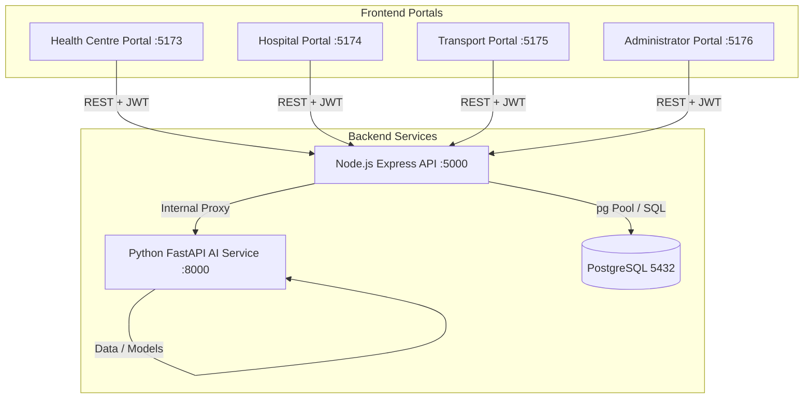

# CareConnect Ethiopia — Software Design Specification (SDS)

## Document Control
- **Document Version:** 1.0.0
- **Classification:** Standard Technical Specification
- **Target Audience:** Full-Stack Engineers, AI Engineers, QA Engineers, Clinical Advisors

---

## 1. System Scope & Architecture Overview

CareConnect Ethiopia is a distributed, modular patient referral management and coordination platform. The system operates as four decoupled single-page application (SPA) frontends communicating with a Node.js/Express main API service and a dedicated Python/FastAPI AI microservice, backed by a relational PostgreSQL database.

---

## 2. Functional Requirements (FR)

### FR-1: Authentication & Role-Based Access Control (RBAC)
- **FR-1.1**: Secure user registration, authentication, and session handling using JWT access tokens (15m expiration) and refresh tokens (7d sliding expiration).
- **FR-1.2**: User roles strictly partitioned:
  - `HEALTH_CENTRE_STAFF` (Health Centre Portal only)
  - `HOSPITAL_STAFF` / `HOSPITAL_TRIAGE` (Hospital Portal only)
  - `TRANSPORT_COORDINATOR` / `AMBULANCE_DRIVER` (Transport Portal only)
  - `SYSTEM_ADMINISTRATOR` / `REGIONAL_OFFICER` (Administrator Portal only)
- **FR-1.3**: Facility-based row tenancy: Health Centre clinicians can only create and access referrals originating from their assigned facility; hospital clinicians can only review incoming referrals targeted to their facility.

### FR-2: Healthcare Facility & Capacity Registry
- **FR-2.1**: Directory of Ethiopian healthcare facilities categorized by tier (`HEALTH_CENTRE`, `PRIMARY_HOSPITAL`, `GENERAL_HOSPITAL`, `TERTIARY_HOSPITAL`).
- **FR-2.2**: Geographic coordinates (latitude/longitude), contact details, catchment area, and administrative region (e.g., Addis Ababa, Oromia, Amhara, Sidama).
- **FR-2.3**: Catalog of clinical services (Obstetrics, Cardiology, Pediatric ICU, Orthopedics, Trauma, Neurology).
- **FR-2.4**: Live capacity reporting: total regular beds, available beds, total ICU beds, available ICU beds, operational ventilators, and timestamped updates.

### FR-3: Patient Registry & Referral Information
- **FR-3.1**: Demographics: Full name, age, gender, national ID / local Kebele ID, phone number, emergency contact.
- **FR-3.2**: Clinical Referral Fields: Primary diagnosis / provisional diagnosis, clinical summary, reason for referral, priority tier (`ROUTINE`, `URGENT`, `EMERGENCY`), required clinical specialty.
- **FR-3.3**: Auto-generated unique human-readable referral identifier: `REF-YYYYMMDD-XXXXX` (e.g., `REF-20261105-00421`).

### FR-4: Referral Workflow & State Transition Engine
- **FR-4.1**: State machine transitions:
  - `DRAFT` ➔ `SUBMITTED`
  - `SUBMITTED` ➔ `ACKNOWLEDGED`
  - `ACKNOWLEDGED` ➔ `ACCEPTED` | `REJECTED` | `INFO_REQUESTED`
  - `INFO_REQUESTED` ➔ `SUBMITTED` (with amended details)
  - `ACCEPTED` ➔ `TRANSPORT_ASSIGNED` ➔ `IN_TRANSIT` ➔ `ARRIVED` ➔ `COMPLETED`
  - `ANY_PRE_TRANSIT` ➔ `CANCELLED`
- **FR-4.2**: Complete chronological event history (`referral_events`) recording actor, action, previous status, new status, timestamp, and notes.

### FR-5: Document Management & OCR Processing
- **FR-5.1**: Multi-part file upload support (PDF, JPEG, PNG) up to 10MB per document.
- **FR-5.2**: Asynchronous or synchronous forwarding to AI Service for optical character recognition (OCR) via Tesseract OCR with OpenCV image enhancement.
- **FR-5.3**: Bilingual text parsing (English and Amharic Fidel script).
- **FR-5.4**: Extraction of key fields: Patient Name, Referring Facility, Referring Doctor, Diagnosis, Vitals, and Urgency.
- **FR-5.5**: Mandatory clinical confirmation: Clinician must verify extracted fields before submission.

### FR-6: AI Decision Support & Facility Recommendation
- **FR-6.1**: Matching patient required specialty against hospital service directories.
- **FR-6.2**: Great-circle / Haversine distance calculation between referring clinic and candidate receiving hospitals.
- **FR-6.3**: Weighted multi-factor ranking scoring:
  - Service capability match (40%)
  - Available bed / ICU capacity (30%)
  - Distance & travel time (20%)
  - Historical triage acceptance rate (10%)
- **FR-6.4**: Explainable recommendation reasoning generated for each recommended facility.
- **FR-6.5**: Review flags identifying high-risk or missing clinical parameters.

### FR-7: Patient Transportation & Logistics
- **FR-7.1**: Creation of transport requests linked to accepted emergency/urgent referrals.
- **FR-7.2**: Resource management of ambulances (Unit ID, plate number, type: Basic Life Support / Advanced Life Support, current status).
- **FR-7.3**: Dispatch tracking: assigned driver, departure timestamp, delay reporting with reason codes, arrival timestamp.
- **FR-7.4**: Interactive GIS map display of referral routes using Leaflet and OpenStreetMap.

### FR-8: System Administration & Audit Logging
- **FR-8.1**: Comprehensive immutable audit logging (`audit_logs`) tracking sensitive patient access, credential updates, and status overrides.
- **FR-8.2**: Dashboard analytical reporting for facility throughput, average referral acceptance turnaround time, bottleneck alerts.

---

## 3. Non-Functional Requirements (NFR)

| ID | Category | Specification |
|---|---|---|
| **NFR-1** | **Performance** | API REST endpoints response time p95 < 250ms under 500 concurrent users. |
| **NFR-2** | **OCR Latency** | OCR document preprocessing and extraction < 5000ms for standard 300 DPI single-page referrals. |
| **NFR-3** | **Security** | Passwords salted and hashed with bcrypt (cost factor 10). Transport encryption via TLS 1.3. |
| **NFR-4** | **Data Privacy** | All patient identifiable data accessible only to authorized health facilities involved in direct referral care. |
| **NFR-5** | **Offline Resilience** | Frontends retain form drafts in IndexedDB/LocalStorage if network connectivity drops. |
| **NFR-6** | **Compatibility** | Fully responsive across standard desktop displays (1920x1080), laptops (1366x768), and mobile tablets (768px). |

---

## 4. Verification & Acceptance Criteria
- Automated unit test suites for all API controllers and business logic services.
- Integration tests simulating the complete lifecycle: referral creation ➔ hospital acceptance ➔ ambulance dispatch ➔ arrival confirmation.
- AI service test suites evaluating classification accuracy, distance calculation correctness, and OCR text extraction.
