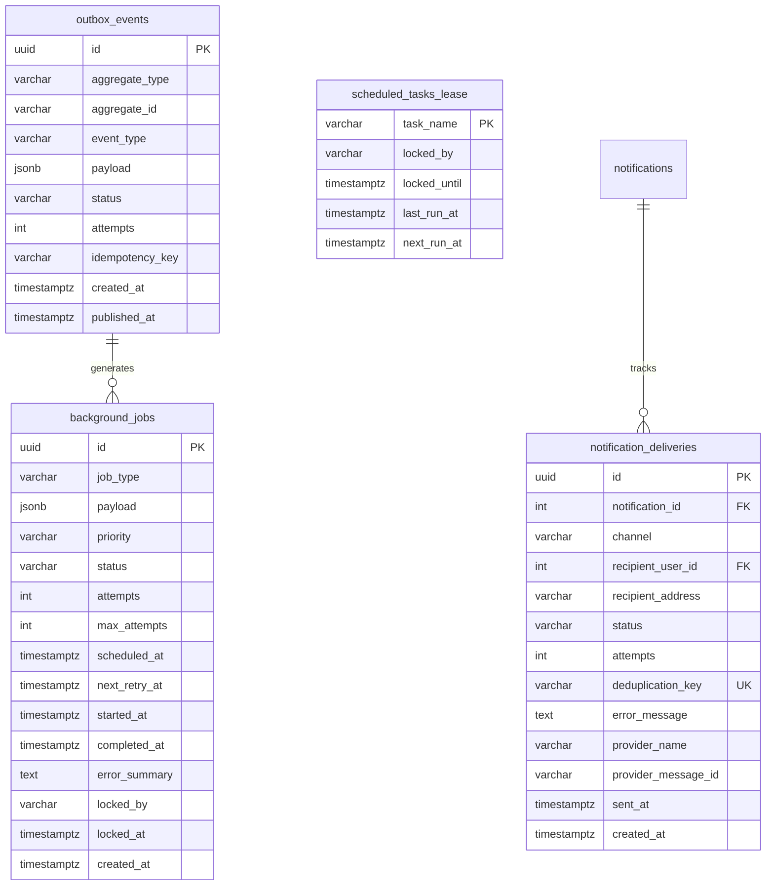

# CARECONNECT ETHIOPIA — PART 12 ARCHITECTURAL ASSESSMENT
## Background Jobs, Scheduling, Outbox Processing and Notification Delivery Infrastructure

---

### 1. Executive Summary & Repository Inspection

A comprehensive inspection of the CareConnect Ethiopia repository was conducted before initiating implementation of Part 12.

#### Existing State & Assets
1. **Database Schema & Migrations**:
   - `014_create_notifications.sql`: Defines `notifications` table (`recipient_user_id`, `recipient_facility_id`, `title`, `message`, `notification_type`, `is_read`, `priority`).
   - `023_notification_ai_audit_schema.sql`: Defines `notification_preferences` (`channel`, `user_id`, event toggles) and `system_events` for observability.
   - `011_create_referral_events.sql`: Defines `referral_events` tracking state machine transitions.
   - `029_referral_coordination_and_escalation.sql`: Defines `referral_response_policies` (SLAs: acknowledgement & decision deadlines), `referral_escalations`, `referral_information_requests`, and `referral_operational_exceptions`.
   - `030_secure_document_management.sql`: Defines document processing preparation and OCR statuses.
2. **Current Limitations Identified**:
   - **No Dedicated Background Job Queue**: Jobs are not decoupled from HTTP requests. Heavy operations (e.g. document analysis, batch SLA checks) risk blocking request loops.
   - **No Transactional Outbox Pattern**: When a referral is created or accepted, database updates and subsequent event dispatching/notifications are not atomically committed, creating risks of phantom notifications or lost events if the process terminates mid-execution.
   - **No Background Scheduler**: Deadline and SLA monitoring are defined in schemas (`referrals.acknowledgement_deadline`, `referrals.decision_deadline`), but currently require manual HTTP triggers rather than an automated, resilient cron/interval scheduler.
   - **No Multi-Channel Notification Delivery Tracking**: While `notifications` records in-app items, there is no delivery tracking infrastructure for SMS/Email channels, provider abstraction, retry tracking, or deduplication.
   - **Absence of Row-Level Concurrency Guards**: Simultaneous worker nodes could claim the same task without PostgreSQL `FOR UPDATE SKIP LOCKED`.

---

### 2. Architectural Decisions & Principles

#### A. PostgreSQL-Backed Job Engine (No External Redis Dependency)
- **Rationale**: The project operates on PostgreSQL / Neon. Introducing Redis or BullMQ adds external infrastructure costs, networking complexity, separate connection pools, and deployment overhead. PostgreSQL provides rock-solid durability, ACID transactions, and row-level locking via `FOR UPDATE SKIP LOCKED`.
- **Performance**: PostgreSQL queues easily handle tens of thousands of jobs per hour, perfectly scaled for national health referral workflows while guaranteeing strict transaction consistency.

#### B. Transactional Outbox Pattern
- **Problem Solved**: Dual-write hazards between database state changes (e.g. referral submitted) and notification delivery.
- **Solution**: Any business transaction inserts an `outbox_events` record within the *same* database transaction. An asynchronous outbox worker safely polls and publishes these events, guaranteeing at-least-once delivery with deduplication.

#### C. Human-in-the-Loop & Ethical Healthcare Mandate
- **Strict Clinical Boundary**: Background jobs and schedulers strictly automate operational tasks (deadline alerts, reminder notifications, transport dispatch updates, escalation alerts).
- **Rule**: A background job must **never** autonomously diagnose a patient, prescribe treatment, or make final clinical referral decisions.

#### D. Privacy & Sensitive PII Protection in Notifications
- External notifications (SMS / Email) must **never** include patient diagnoses, clinical notes, or full patronymic identities.
- Notifications supply safe operational identifiers (e.g., `REF-2026-0042`) and secure, authenticated deep-links into the respective CareConnect portal.

---

### 3. Proposed Schema Additions (`035_background_jobs_and_outbox_schema.sql`)

---

### 4. Implementation Plan (Commits 089 – 096)

1. **Commit 089**: `backend: establish background job processing architecture`
   - Migration `035_background_jobs_and_outbox_schema.sql` (defining `background_jobs`, `outbox_events`, `notification_deliveries`, `scheduled_tasks_lease`).
   - Job queue service `JobQueueService` and worker abstraction `JobWorker`.
   - Core job definitions & registry (`JobRegistry`).
2. **Commit 090**: `backend: implement reliable job execution and retry handling`
   - Safe job claiming using `FOR UPDATE SKIP LOCKED`.
   - Crash recovery & abandoned job lease sweeper.
   - Exponential backoff retry calculations with jitter.
   - Transient vs. permanent error classification.
3. **Commit 091**: `backend: implement transactional outbox event processing`
   - Atomic business transaction helper (`OutboxService.createEventWithinTransaction`).
   - Asynchronous outbox dispatcher worker.
   - Outbox event handlers for referral status changes and coordination actions.
4. **Commit 092**: `backend: implement scheduling and recurring job infrastructure`
   - `SchedulerService` supporting one-time delayed jobs and recurring cron intervals.
   - Multi-replica distributed task leasing (`scheduled_tasks_lease`) preventing duplicate executions.
   - Timezone-safe calculations (UTC internally, EAT / UTC+3 display formatting).
   - Missed-schedule catch-up logic.
5. **Commit 093**: `backend: automate referral deadline and escalation processing`
   - Referral SLA monitor job (`ReferralSlaMonitorJob`).
   - Acknowledgement and decision deadline breach detection.
   - Automated creation of `referral_escalations` and `referral_operational_exceptions`.
   - Preservation of human clinician oversight.
6. **Commit 094**: `backend: implement notification delivery infrastructure`
   - Pluggable provider architecture: `InAppNotificationProvider`, `EmailNotificationProvider`, `SmsNotificationProvider`.
   - Template engine with safe non-PII sanitization and portal links.
   - Deduplication key tracking to prevent duplicate message dispatch.
7. **Commit 095**: `backend: implement job and notification monitoring`
   - Operational monitoring endpoints for administrators (`/api/v1/jobs/metrics`, `/api/v1/jobs/failed`, `/api/v1/outbox/backlog`).
   - Administrative retry and cancellation commands with audit logging.
8. **Commit 096**: `test: verify background processing scheduling and delivery reliability`
   - Multi-scenario test suite `part12Comprehensive.test.js`.
   - Full regression verification across all 566+ backend tests and 38 database tests.
   - Documentation in `docs/PART_12_REPORT.md` and `docs/DEVELOPMENT_PROGRESS.md`.
